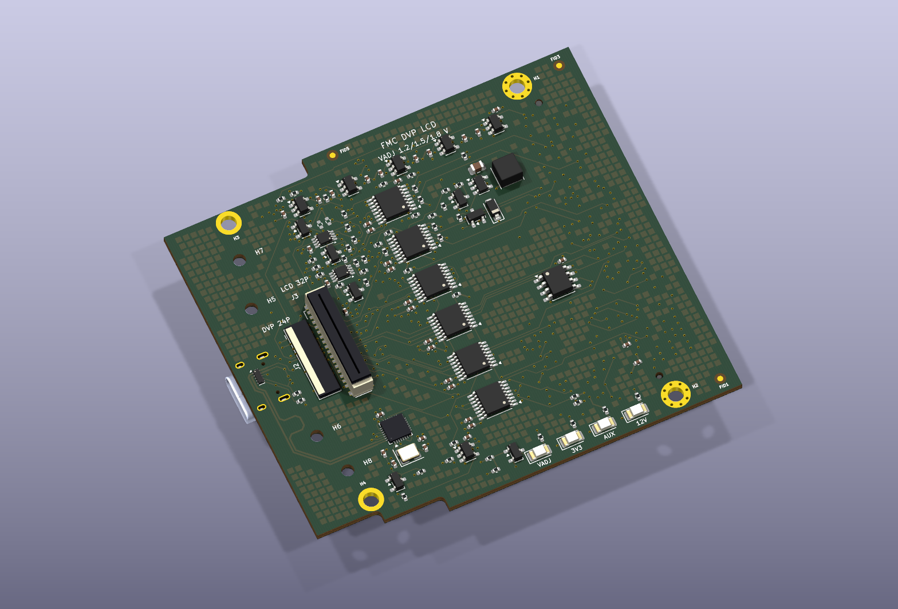
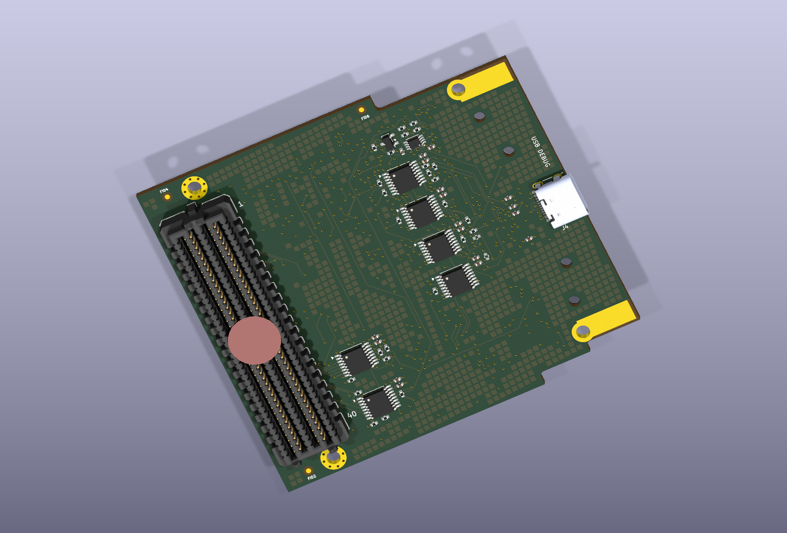

# FMC DVP/LCD

Engineering prototype for a TY-OV5640-FD autofocus DVP camera, a 32-contact
86-series 8080 LCD, and simultaneous CH347F JTAG/UART0 over USB-C.





Open `fmc_dvp_lcd.kicad_pro`. The six A4 sheets cover the system, FMC/FRU,
camera, LCD/touch, USB debug, and power. The interfaces are designed for
1.2 V, 1.5 V, or 1.8 V VADJ. The FRU still requests 1.8 V pending hardware
validation. The 54 LA signals use verified VCU118 J22 general-purpose I/O. CAM_PCLK uses AJ32 and JTAG TCK
uses R34. Both are GC P inputs. No MGT resources are used.

Level translation uses twelve AiP74AVC4T774TA16.TR devices and three Nexperia
LSF0102DCH devices. Each AVC channel has a defined direction. LCD data retains
readback, common DIR, and active-low OE. The camera has a local regulated
1.8 V I/O rail. LCD VCC and IOVCC use 3.0 V. CH347F VIO and its reset logic use
fixed 3.3 V. VADJ supplies the FPGA side of the translators.

The LSF reference uses a 150 ohm / 910 ohm divider from VADJ. Separate 200 kohm
bias resistors and carrier-PG clamps serve the three LSF devices. Both sides
have pull-ups. Configure FPGA SCCB and touch SCL, SDA, INT, and RESET as
open-drain or released inputs. Start these buses at 100 kHz. Check rise time,
module pull-ups, and sink current before increasing the bus rate. Touch
reference selection remains an assembly option.

Camera DOVDD is always on while main 3.3 V is present. Firmware must enable
AVDD after DOVDD settles and hold camera RESET low and PWDN high during
startup. Camera and autofocus enables pass through the fixed 3.3 V bridge
translation bank. The backlight uses a non-inverting NPN driver after its
3.0 V translator to provide full 3.3 V PWM and a defined off state.

FMC GPIO and translator channels are assigned across each complete signal chain to reduce routing crossings.
Direction straps and enable controls follow the peripheral voltage domains.
CAM_PCLK remains at H7 / AJ32. JTAG TCK remains at D20 / R34.
CAM_MCLK remains at G7 / AL36. Their translator channels remain fixed.
The schematic, PCB, and `data/vcu118_j22_io.json` use the same assignment.
The mapping includes each translated signal's translator reference and paired A/B pins.
The six-layer PCB connects all 139 checked signal nets and all 54 FMC signal nets.

The four-layer `fmc_sdram` board provides the reference fanout and fabrication profile.
Its signal tracks use the outer layers. `fmc_basic_peripheral` uses six copper layers.
Its reference file, `fmc_usb_gpio_spi_jtag.kicad_pcb`, uses four signal layers.
This board uses three signal layers and retains the two translator part types.

CH347F accesses a programmed fabric TAP. FPGA configuration and ILA use the
VCU118 native USB JTAG. The FMC native TDI/TDO bypass is retained.

The PCB contains grouped signal routing. LCD translators and USB bridge circuitry use the front.
USB-C J4 remains on the back. Camera and JTAG/UART groups use B.Cu. Short connector escapes use the opposite
signal layer. The six-layer order is F.Cu signals, In1.Cu ground, In2.Cu power,
In3.Cu signals, In4.Cu power, and B.Cu signals. The nominal thickness is 1.6 mm. The stackup needs fabrication
confirmation. Supply and ground fanout is connected for the sixteen plane domains.
All three plane layers are filled.
Signal routing is connected. Return-path and timing validation remain incomplete.

The base outline, FMC connector, original mounting holes, fiducials and drill/place
origin are retained. H5-H8 are four 2.2 mm M2 holes for the printed supports.
Camera bypass capacitors C4-C7 sit on the back below the FPC power contacts.
Camera and JTAG/UART translator capacitors share their IC side. LCD translators
and regulator cells use the front. Repeated translator cells use an 8 mm pitch.
The five regulator cells use a 9 mm pitch.
Four orange GL1206UO01 (C51933322) 1206 LEDs form a 6 mm pitch row on the front near the lower board edge.
They indicate VADJ, main 3.3 V, auxiliary 3.3 V, and 12 V. Matching resistor cells share one row.
The VADJ indicator uses MMBT3904 Q8 and also requires main 3.3 V. It indicates presence, not power-good.
The resistors and transistor reuse existing BOM types. Only the LED part type is new.
The LED body measures 3.2 x 1.6 x 0.9 mm. Nominal current remains about 1 mA.
Check visibility on the assembled board.

Two bottom contact windows beside H3 and H4 follow the JTAG reference board.
Each window exposes continuous GND copper. New zones keep at least 0.5 mm board-edge clearance.
The dummy copper group avoids these windows. H1-H4 retain their original plated holes, ground rings, and pad-edge exceptions.
The existing direct connection to circuit GND is retained. This does not establish FMC chassis-isolation compliance.
The lower FMC row labels move clear of the H2 ground ring.
R31 sits beside the backlight driver. R45, R47 and R49 sit beside their clamp transistors.
The LCD data routes use grouped 45-degree paths. Camera D5-D7 share a 22.5 mm
inner-layer ribbon at 0.40 mm pitch. LCD DB4-DB6 share a 12.2 mm front-layer
ribbon at the same pitch. LCD DB0-DB3 use a 0.952 mm inner-layer pitch.
The three adjustable debug signals share 9.77 mm at 0.2787 mm pitch.
Indicator feeds connect to the inner power regions.
The FMC_DVP_LCD_DUMMY_COPPER group contains 723 front and 804 back isolated copper squares.
Each square is 1 mm wide, with a 1.35 mm lattice pitch and 0.125 mm row/column shifts.
The squares remain under solder mask. Group rules require 0.30 mm copper spacing and 0.50 mm edge clearance.
Regenerate the group after moving nearby copper. Parameters are stored in placement-rules.json.
The pattern is decorative. Fabricator copper balance and signal integrity remain unverified.
Signal routes have no exposed same-net overlaps, self-crossings or acute junctions.
Free corners use 45-degree chamfers. Branches use perpendicular T or non-acute Y junctions.
Connector fanout adds
short branches and layer changes. Dense component references are on the
fabrication layer. Connector and voltage markings remain on silkscreen.
Assembly markings need a final review.
Placement constraints and the power-layer plan are in `placement-rules.json`.

In1.Cu is the ground plane. In2.Cu carries sixteen separate supply and reference domains.
In4.Cu carries main 3.3 V and isolated supply bridges. In3.Cu carries signal routes.
Supply pins and capacitors use local surface fanout to nearby vias.
Short surface bridges connect power regions across other domains.
Unused inner via annuli are removed. General vias use 0.50 mm lands and 0.30 mm drills.
The three existing USB vias retain their 0.60 mm lands.
The default clearance is 0.127 mm, with a 0.10 mm minimum via annular ring.
USB retains its 0.20 mm clearance. The inner-zone clearance remains 0.20 mm.
Native checks report zero opens across the sixteen plane domains and ground.
The backlight switch node uses 0.35 mm tracks. Its loop still needs switching tests.
Native DRC reports zero unconnected items, geometric errors, and schematic parity errors.
No dangling copper, isolated fill, or narrow-copper warnings remain.
ERC has no violations after replacing 47 local power labels with power symbols.
The complete schematic pin-to-net map is unchanged.
J4 has one documented footprint library mismatch exclusion in the project settings.
Its board-specific graphics and 3D model settings differ from the library.
Pad numbers, copper, mask, paste and holes match the library.
DRC reports zero unexcluded errors or warnings in KiCad 10.0.8.
FID1-FID6 match the installed fiducial footprint and are excluded from the BOM.
Some through vias lie in SMD pads. Confirm via filling and capping with the fabricator.
Fabricator stackup, USB impedance, return paths, and hardware tests remain unverified.

USB-C J4 is centered below the camera on the back at the front edge.
The cable exits forward between the original front mounting points.
The camera cap has a 16 mm central notch. The assumed USB plug is 14 mm wide.
Actual cable, carrier-board, and metal-bezel fit remain unverified.

The FDM prototype uses four small supports attached at H5-H8 with M2 screws.
The original H1-H4 holes remain unchanged. Four flat tabs retain the LCD.
A screwed rear plate retains the camera. Loose nuts replace printed snap fits.
The design uses 11 printed parts and 13 M2 screws. Its printed width is 54 mm.
The camera and LCD have independent hinges for nominal 0-90 degree travel.
Use 0.4 mm nozzle and 0.2 mm layers as the slicing starting point.
STL exports lie flat on the bed. Add a 3 mm brim when slicing the two camera supports.
Soft back pads are trapped between the modules and retainers without adhesive.
Pad material, clamp force, hinge torque, tolerances and cable travel need physical validation.
Mechanical metadata is recorded in `placement-rules.json`.
Sources are in `mechanical/camera_lcd/`.
With FreeCAD installed, `cmake --build build --target mechanical` generates
FCStd, STEP, STL, and motion meshes under `build/mechanical/camera_lcd/`.
PCB outline and module geometry come from `reference.FCStd`.
Update this reference and `parameters.json` when their geometry changes.
Part STEP files retain assembly coordinates. STL orientations are recorded in `print-orientations.json`.
Connector envelopes and support geometry are defined in `assembly.py`.
Short USB connector stubs use three vias to reach F.Cu.
The ESD device uses its optional flow-through lands and a short ground branch.
The USB pair uses 0.30 mm main tracks and a 0.20 mm gap.
The symmetric CH347 escape neck uses 0.20 mm tracks and a 0.20 mm gap.
One broad D- tuning bend compensates the connector escape and main-path difference.
Modeled PCB path mismatch is below 0.01 mm for both plug orientations.
The tuning section is locally uncoupled. The filled In1.Cu plane provides the ground reference.
USB return-path and impedance validation still need the confirmed fabrication stackup.
Production exports are development artifacts and are not manufacturing approval.

The camera uses a 1 mm high horizontal FH34SRJ-24S-0.5SH placement candidate. The LCD uses
a vertical FH12-32S-0.5SVA footprint based on the manufacturer's staggered land
pattern. Camera FPC thickness, exposed length, width and pin-1 orientation still need
confirmation. The LCD contact face also remains unconfirmed. The camera
carrier leaves the connector area open. External camera DVDD and AF feed links are DNP pending module confirmation. Both touch
reference selectors are DNP. Populate one only after verifying the supplied touch
module's I/O voltage. CH347F datasheet V1.4 confirms the nominal 2.7 mm exposed
pad. Assembly validation remains pending. The default backlight target is
90 mA for E2886BP. The conservative straight-root LCD cable model does not
cover the full 0-90 degree travel. Root folding or an extension and a matching
mechanical check are required before the assembly can be frozen.

Install KiCad 10 with its libraries, CMake 3.18 or later, Ninja and frugy.
Initialize the `library` submodule before opening the project. FreeCAD is required for the mechanical target.
Project library tables include the required official libraries and work without a personal KiCad configuration.
Run these commands from the `fmc_dvp_lcd` directory:

```sh
cmake -B build -G Ninja
cmake --build build --target erc drc pdf eeprom
```

The `drc` target checks errors, warnings and schematic/PCB parity, honoring project exclusions.
To include excluded findings in a separate report, run:

```sh
kicad-cli pcb drc --severity-all --schematic-parity -o build/drc-all.rpt fmc_dvp_lcd.kicad_pcb
```

The `production` target exports
development Gerbers, drill files, BOM and XML netlist.

The FRU image targets the 8192-byte M24C64. The prototype serial number must be
replaced by a unique board serial number before production.
