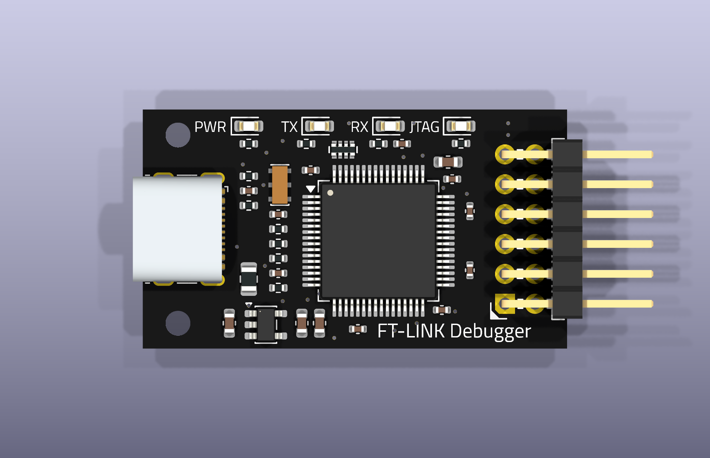
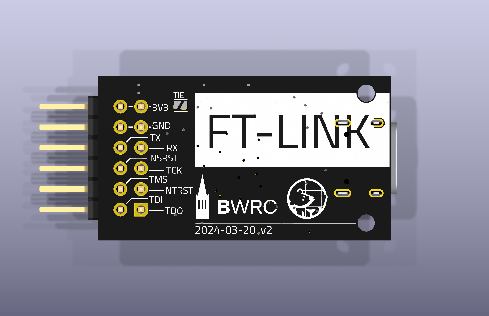

# PMOD_FT_LINK

FT-LINK is a USB-to-JTAG and UART adapter built around the FT2232HL. It
connects to a 12-pin Pmod GPIO port with 3.3 V logic. Channel A provides
JTAG through MPSSE; channel B provides UART.

**Keep JP1, marked TIE on the back, open when the host supplies Pmod power.**
The adapter has fixed 3.3 V I/O; it does not sense the target voltage or
translate logic levels. Power the target before driving its signal pins.

## 3D view

### Top view



### Bottom view



## Introduction

### Pmod

The board uses the mechanical dimensions, connector pitch and power-pin
positions of the [Pmod Interface Specification 1.2.0](https://digilent.com/reference/_media/reference/pmod/pmod-interface-specification-1_2_0.pdf).
Its outline is 36.00 × 20.32 mm, with a 1.6 mm thick, two-layer PCB and a
right-angle male connector on 2.54 mm pitch. Specify black solder mask and
white silkscreen on both sides when ordering.

The GPIO assignments below are specific to FT-LINK. This is not an ARM
20-pin or Cortex 10-pin JTAG connector. The FPGA pin constraints and debug
software must use this mapping; a Pmod GPIO port does not automatically
connect to the FPGA's dedicated configuration JTAG chain.

Pmod numbers each six-pin row consecutively. The original FT-LINK drawing
and the VCU118 documentation use alternating odd/even numbering for the
same physical contacts:

| Pmod pin | Original / VCU118 pin | Signal | Direction at FT-LINK | FT2232HL pin |
| --- | --- | --- | --- | --- |
| 1 | 1 | TDO | Input | 18, ADBUS2 |
| 2 | 3 | NTRST | Output, active low | 26, ACBUS0 |
| 3 | 5 | TCK | Output | 16, ADBUS0 |
| 4 | 7 | RXD | Input | 39, BDBUS1 |
| 5 | 9 | GND | Ground | |
| 6 | 11 | PMOD_VCC | Host power rail | |
| 7 | 2 | TDI | Output | 17, ADBUS1 |
| 8 | 4 | TMS | Output | 19, ADBUS3 |
| 9 | 6 | NSRST | Output, active low | 27, ACBUS1 |
| 10 | 8 | TXD | Output | 38, BDBUS0 |
| 11 | 10 | GND | Ground | |
| 12 | 12 | PMOD_VCC | Host power rail | |

Connect TXD to the target's RX input and RXD to its TX output. The JTAG
clock/data signals use the FT2232H MPSSE assignments; the Pmod contact order
is the original FT-LINK order.

### Power and TIE jumper

USB VBUS supplies the FT2232HL through the resettable fuse and AP2112K-3.3
regulator. Pmod pins 6 and 12 are power pins, not VTref inputs. They form the
separate `PMOD_VCC` net while JP1 is open.

JP1 is the original pair of complementary diagonal solder pads, previously
labelled R11 in the source schematic. It is not a resistor or a permanent
net tie. The KiCad symbol is `Jumper:SolderJumper_2_Open`; the custom footprint
is in `CHIPSAlliance_Jumper`. Its copper and stencil shapes follow the
original Gerbers. No component is fitted, so it is excluded from the BOM
and placement files and has no component 3D model.

Bridging JP1 with solder connects USB-derived 3.3 V to the Pmod power rail.
Leave it open for a separately powered host. Closing it requires a deliberate
single-supply arrangement and a verified current budget. An open jumper
isolates the power rails, but does not isolate the signal pins from an
unpowered target.

### Clock

Y1 retains the author's Murata `CSTNE12M0GH5C000R0` ceramic resonator
(LCSC `C2659460`): 12 MHz, 3.2 × 1.3 mm, with two built-in 33 pF capacitors.
There are no added external load capacitors. The `Device:Resonator` symbol
and the CHIPSAlliance footprint retain its three-terminal circuit and the
manufacturer's recommended lands.

Its ±0.07% (±700 ppm) initial tolerance is outside FTDI's recommended
±30 ppm crystal specification. Retaining the original circuit does not
establish compliance with that recommendation, nor prove it cannot work.
Confirm oscillator start-up, frequency over the intended operating range,
and USB operation on assembled hardware before production.

### LEDs

| Reference | Color | Marking / function |
| --- | --- | --- |
| D1 | Red | PWR, USB-derived 3.3 V present |
| D2 | White | TX, driven by FTDI RXLED# |
| D3 | White | RX, driven by FTDI TXLED# |
| D4 | Blue | JTAG, driven by ACBUS3 |

The original TX/RX silkscreen and LED wiring are retained. Their markings
use the opposite perspective to the FTDI RXLED#/TXLED# signal names. JTAG
LED behavior depends on the software's ACBUS3 configuration.

## Preparation

Install KiCad 10, CMake and Ninja, then initialize the pinned library:

```sh
git submodule update --init pmod_ft_link/library
cd pmod_ft_link
```

Open `pmod_ft_link.kicad_pro` in KiCad. The schematic fits one landscape A4
sheet and uses the project's CHIPSAlliance drawing template. Board text
uses embedded Titillium Web Regular; installing the font separately is not
required to view the saved design.

## Build

```sh
cmake -G Ninja -B build
cmake --build build
```

Individual targets are available:

```sh
cmake --build build --target erc drc
cmake --build build --target pdf
cmake --build build --target production
```

Production output contains two-layer Gerbers, separate plated/non-plated
drill files, BOM and SMT placement data. The drill/placement origin is the
lower-left board corner; bottom placement X is negated. Silkscreen export
subtracts solder-mask openings. Generated files stay under `build/`.

J1 is a hybrid USB connector with SMT contacts and plated shield slots;
J2 is through-hole. Both original component placement and signal routing
are retained apart from changes needed for the native footprints and Pmod
mechanics. J1's locating holes use a local 0.10 mm pad-to-hole clearance
matching its land pattern; routed copper retains 0.25 mm hole clearance.

Native DRC retains advisories for the original small regular-weight board
lettering, the intentional negative-text panel, and J1/J2 library-instance
silkscreen adjustments. The generic F1/J2 symbol footprint filters also
produce advisories. These are not hidden. ERC/DRC do not replace hardware
checks of the clock, USB signal integrity, power budget or target compatibility.

## Origin and licenses

Original designer: **-T.K.-**, `t_k_233@outlook.com`, UC Berkeley.
The design comes from [PR #2](https://github.com/chipsalliance/rocket-pcb/pull/2),
source commit `8a24312734b0e4b31bfd77401dffb280b939f82e`.
The title blocks retain the original schematic date **2024-02-29**, PCB date
**2024-03-20**, and revision **V2.0.0**.

The native KiCad migration preserves the circuit, artwork and clock choice,
uses standard or CHIPSAlliance library assets, and renames the solder bridge
from R11 to JP1. The original artwork remains editable vector geometry;
the board lettering uses native editable text. No EasyEDA source archives,
manufacturing outputs or review reports are required in this directory.

The source font name was `ACME Titillium Web Regular`. Board lettering now
uses the unmodified [Titillium Web Regular font from Google Fonts](https://github.com/google/fonts/tree/main/ofl/titilliumweb),
embedded in `pmod_ft_link.kicad_pcb`. Its copyright notice and full SIL Open
Font License 1.1 are in [licenses/TitilliumWeb-OFL.txt](./licenses/TitilliumWeb-OFL.txt).
The OFL permits commercial design use and embedding under its distribution
conditions. The ACME font binary is not redistributed. Library reference
and fabrication fields retain KiCad's default font, as required by KLC.

## References

- [FT2232H datasheet, oscillator section 6.3](https://ftdichip.com/wp-content/uploads/2024/05/DS_FT2232H.pdf)
- [Murata CSTNE12M0GH5C000R0 specification](https://www.murata.com/products/productdata/8801162100766/SPEC-CSTNE12M0GH5C000R0.pdf)
- [Kinghelm KH-TYPE-C-16P drawing](https://www.kinghelm.com.cn/upload/file/20220505/KH-TYPE-C-16P.pdf)
